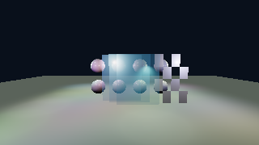
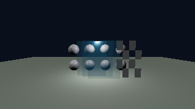

# Slice 5D: clustered lighting and ordinary meshes

Status: implemented, 2026-10-22. Debug/Release and software-Vulkan verification pass;
RTX 3060 profiling and live windowed review remain pending. This document records the lighting/scene contract. Drawing and depth are extended by
[slice 5E](rendering_gpu_visibility.md). See [roadmap](rendering_roadmap.md).

## Responsibilities and interfaces

CPU scene storage owns generation-checked, dense light/instance tables. Immutable
indexed triangle primitives have position, normal, tangent/handedness and UV0.
Instances reference geometry and materials independently. This is the input boundary
for future glTF import; no importer, node hierarchy, skinning or animation is added.
World positions use 1024 m integer XZ cells and double local coordinates. Camera-relative
conversion precedes conversion to float and is independent of terrain tile size.
`Renderer` exposes create/update/remove light and instance operations, immutable mesh/texture
upload and material creation/release, and `sceneStats()`. The public definitions are in
`scene.hpp`; GPU details stay in `VulkanClusters`, `VulkanMeshes` and `VulkanMaterials`.

Defaults: 4096 lights, 4096 instances, 256 primitives, 64 shared material records,
64 MiB geometry, existing 320 MiB image budget, 64 MiB cluster storage per frame.
Exhaustion rejects creation. Invalid mesh references skip draws; stale materials and
textures use fallbacks. CPU updates are render-thread operations.

Vulkan scene resources own immutable mesh allocations and per-frame instance records.
Vulkan clustered lighting owns per-frame light snapshots, assignment storage and
completed-frame diagnostics. Renderer orders these systems with the existing material
library, terrain and output/UI passes. No generation/cache changes are involved.
Geometry uses immutable device-local buffers with staging transfers, bounded by both
primitive slots and driver-reported allocation bytes. Staging is released after an
uploading frame completes; its peak is bounded by the outstanding geometry payload.
The two 144-byte-per-instance upload arrays cost 1.125 MiB at the default capacity.
Assets allocate only in explicit upload operations. Frame snapshots retain resources
until their fences complete. Retired allocations count against budgets; resource
churn cannot grow an unbounded retirement queue. Ordinary updates and sorting reuse
preallocated storage. Resize uses the renderer's existing idle boundary.

## Lighting and assignment

Sun and environment remain outside local lists. Local modes are disabled, brute-force
reference and clustered. Point/spot intensity is candela, range and source radius are
metres; spots point outwards and have ordered inner/outer half angles below 90 degrees.
Attenuation is max(1-(distance/range)^4,0)^2 / max(distance^2,radius^2), multiplied
by squared clamped cone-cosine interpolation. Lighting uses the shared GGX BRDF and
one final pre-exposure. No local shadows or normal-based cluster rejection.

Start at 32-pixel XY tiles, 24 logarithmic slices over the camera near/far range and
64 indices per cluster. Each light workgroup visits conservative screen/depth bounds
and intersects its range sphere with cluster AABBs. Spot cones use conservative sphere
assignment and exact angular evaluation in shading. Near-plane intersections cover
all XY tiles. Lists cover the complete frustum without opaque-depth pruning.
Overflow scans the entire bounded active-light array instead of using the partial
list. Tile size doubles on resize if necessary to fit the cluster budget. Counters
are cleared before assignment, then compute writes are made visible to fragment reads.
Cluster counts are copied into preallocated host-visible readback storage after assignment;
completed counts produce occupancy/overflow statistics on the CPU. These diagnostic copies
are included in assignment timing. Diagnostics and timestamps are consumed only after the
frame fence, without extra waits. The lighting set adds bindings 4–8 for lights, counts,
indices, cluster uniforms and bounds; mesh set 0 contains instance records. Bounds are
shared between frame slots. Budget selection includes bounds, counts, indices, readback,
lights and alignment allowance; actual allocation totals are checked before use.

## Materials and passes

Mesh factors/maps support base colour/opacity, normal, ORM (R AO, G roughness,
B metallic), emissive, alpha mode/cutoff and double sidedness. Terrain scalar packing
is unchanged. Colour/emissive are sRGB, other maps linear; material creation rejects mismatched live
texture formats. Uploads require complete mip chains and supported sampled/filterable
formats. Missing normal maps preserve the geometric normal exactly. An unlit flag supports
owned HDR swatches and ordinary unlit meshes; their base colour plus emissive still use
exposure, alpha rules and output transform. Mesh emission accepts up to 1e9 per channel
(the retained HDR fixture reaches 4,096,000); final storage clamps to finite FP16. The shared library publishes
material records and texture descriptors per completed frame. Bindless uses bounded
2D arrays; fixed mode uses eight descriptors and literal-index shader branches. Three 2D fallback
slots are reserved (white colour, neutral normal, white data), leaving five custom fixed-path
images. Bindless has up to 128 queried slots. Terrain array slots and packing are separate.
The shared 64-entry record table reserves zero for fallback and 1–4 for terrain, leaving
59 immutable mesh materials. Retired texture slots cannot be reused until both descriptor
snapshots release them.

Pass order: uploads, assignment, optional opaque depth, opaque/masked shading,
back-to-front transparent meshes, output transform, UI. Alpha masking shares colour
and depth evaluation; future shadows must use the same helper. Blend output is
premultiplied pre-exposed linear HDR with ONE / ONE_MINUS_SRC_ALPHA, depth test on,
writes off. Sorting uses transformed bounds-centre view depth plus stable handle ID;
intersections and within-mesh triangle ordering are limitations. Mirrored transforms
adjust winding and tangent handedness; double-sided backfaces reverse shading normals.
Sampled depth, Hi-Z, indirect drawing, OIT and refraction remain deferred.

The user-facing material preview is removed. Generated ordinary mesh fixtures retain
PBR/exposure coverage; tools own terrain-material fixture shaders. Hiding terrain
retains the last terrain observer while pending work continues. A toggleable terrain
demo anchors generated lights and meshes at activation, rather than following the camera.

## Verification strategy

CPU tests cover handles, bounds/exhaustion, coordinates, invalid input, attenuation,
transforms and sorting. Small owned GPU fixtures compare clustered/brute-force HDR
(tolerance 2e-4 + 3e-3 * abs(reference), unsaturated FP16), independently check CPU
BRDF results, and cover near/slice/tile boundaries, camera-inside lights, zero lights,
overflow, masks, blend composition, double sides and mirrored transforms. Validate
both descriptor paths, resize and resource churn with two frames in flight. Migrate
existing preview-dependent tests/probes and run Debug/Release regressions.

Separate Release profiling sweeps 0/32/256/1024/4096 lights, sparse/overlapping
arrangements, transparency depth and 1080p/4K. Report median/p95 CPU and GPU costs,
assignment/opaque/transparent timings, occupancy, overflow and allocated bytes.
Software Vulkan is correctness evidence, not RTX 3060 performance evidence.

## Reproduction and limits

```sh
cmake --build cmake-build-release --target engine lighting_probe
cmake-build-release/engine --lighting-demo --require-validation
# In Lighting & Materials, use Evening lighting for a local-light comparison.
cmake-build-release/lighting_probe /tmp/lighting-review --require-validation
# Small software-Vulkan smoke; does not establish production-scale performance.
cmake-build-release/lighting_probe /tmp/lighting-smoke --quick --frames 4 --require-validation
```

The full probe sweeps 1080p/4K, 0/32/256/1024/4096 lights, sparse/overlapping
arrangements, 0/3/8 transparent layers, and brute/clustered paths. `--lights N`
selects one count; `--fixed` exercises fallback binding. CSV contains median/p95 CPU
submission/frame-fence costs, total scene and assignment/opaque/blend GPU times,
occupancy, overflow and allocation totals. Timestamps have an availability flag.
Output captures and device/build-mode parameters accompany the measurements.
The quick sweep uses 320×180 and 0/32/256 lights. No speedup claim is based on software Vulkan.

Mesh geometry is immutable; updates replace a resource and redirect instances. There is
no scene graph, importer, mesh LOD, local shadow, refraction or OIT. GPU visibility and
sampled depth are implemented by [slice 5E](rendering_gpu_visibility.md). Sorted transparency orders instances, not triangles or intersections. The first
spot culler uses range spheres: wide candidate coverage and highly overlapping lights
can force expensive brute-force fallback. Tile dimensions coarsen when the fixed budget
requires it. Explicit asset operations and resize can allocate/block; ordinary scene
updates cannot grow containers. The material library's existing finite asset budget also
includes pending retirement. World-position validation bounds cells to ±1e12 and finite
locals to ±1e15; for local precision, normalize translations with `translated()`.

## Verification results (2026-10-22)

- Debug full regression: **22/22 passed**, 208.05 s. Release full regression:
  **22/22 passed**, 171.96 s. Subsequent focused scene/lighting/material/smoke reruns
  passed **5/5** in both builds after final resource/timing hardening.
- `scene_gpu` exercises both actual bindless and forced-fixed paths on llvmpipe
  (LLVM 23.1.3), with Vulkan synchronization validation and no reported errors.
  Tests include independent point/spot/normal/ORM BRDF checks, exact opacity endpoints,
  mirrored tangents, both sides, masks, terrain occlusion, prepass equivalence, large-world
  rebasing, odd-size resize, near-plane/camera-inside cases, logarithmic slice boundaries,
  list overflow and submitted-reader resource retirement. HDR reference comparisons use
  the tolerance above. `scene_cpu` observes zero C++ allocations during repeated bounded
  create/update/remove operations after construction; driver-wide frame allocations are
  not instrumented.
- Eight new mesh/cluster SPIR-V modules pass `spirv-val --target-env vulkan1.3`.
- The headless application ran eight frames with `--lighting-demo`, a generated 16 m
  terrain fixture and no production assets: one terrain generation, zero validation errors.
- The migrated material probe's four-layer cliff workload completed with the production
  palette, reporting 24 logical texture reads and no validation errors. This separate
  tool check is not a routine test dependency on production artwork.
- Separate 320×180 light sweeps completed at 32 and 4,096 lights, sparse/overlapping
  placement, 0/3/8 transparent layers and both lighting paths, with validation enabled.
  Both sweeps used 1,330,944 bytes of cluster storage and 39,432 bytes of fixture geometry.
  The 4,096-light overlap case reached occupancy 4,096 and 586 overflow clusters.

The following **software smoke measurements** use three transparent layers and only
four samples (32 lights) or two samples (4,096 lights), after four warm-up frames.
They verify timing/overflow plumbing, not stable performance or tail latency.

| Lights / distribution | Brute scene median | Clustered scene median | Assignment median | Maximum occupancy / overflow clusters |
| --- | ---: | ---: | ---: | ---: |
| 32 sparse | 4.597 ms | 5.399 ms | 0.155 ms | 25 / 0 |
| 32 overlapping | 5.625 ms | 8.709 ms | 0.169 ms | 32 / 0 |
| 4,096 sparse | 160.054 ms | 143.193 ms | 0.737 ms | 502 / 190 |
| 4,096 overlapping | 438.606 ms | 439.265 ms | 3.585 ms | 4,096 / 586 |

Raw median/p95 rows and metadata: [32 lights](measurements/rendering_5d/32_lights.csv),
[4,096 lights](measurements/rendering_5d/4096_lights.csv). Small-light clustering overhead
and the cost of dense overlap are visible. Capacities have **not** been tuned from
software timings; the default remains 64 indices and a correct overflow fallback.

Reviewed captures show ordinary opaque spheres, alpha-cutout panels and three lit
transparent layers over opaque terrain:





The NVIDIA driver is unavailable (`nvidia-smi` cannot communicate with it). No RTX 3060,
1080p/4K target-GPU budget, live windowed motion review or production-scale allocation
profile is claimed. Those checks remain explicit follow-up verification.
