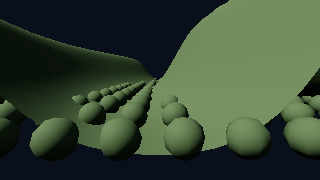
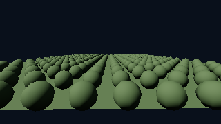

# GPU drawing and conservative visibility (slice 5E)

Status: implemented (2026-10-22), with Debug/Release and software Vulkan verification.
RTX 3060 and live windowed review remain pending. See [roadmap](rendering_roadmap.md).

## Responsibilities and interfaces

CPU terrain residency, LOD selection and mesh resource ownership remain unchanged.
`VulkanVisibility` owns two frame slots of bounded candidates, 128-byte terrain draw
records, batches, GPU-generated indexed commands and counters. Mesh records remain
owned by `VulkanMeshes`. `VisibilityMode` selects Direct, Indirect (default), or HiZ.
HiZ forces retained opaque/masked depth; transparency remains sorted and direct.
Wireframe uses Direct. No previous-frame visibility/depth affects rendering decisions.

Candidates contain conservative camera-relative AABBs, a validity flag and geometry/
source-record indices. Compatible terrain descriptor/LOD and mesh geometry/pipeline
runs are split into at most 128 candidates (also bounded by maxDrawIndirectCount).
The 128-thread choice fits the baseline compute workgroup limit.
One compute workgroup per batch tests bounds and performs a stable inclusive scan,
then scatters commands in source order. This bounds scan scratch and dispatch work
without global atomics or cross-workgroup synchronization. Counts never exceed the
input batch size. Fixed-command fallback clears unused instance counts every pass.
`firstInstance` preserves source identity through DXC `SV_InstanceID`/SPIR-V `InstanceIndex`;
do not enable DXC's nonzero-base-instance subtraction option for these shaders. Direct rendering shares prepared records
and batch ordering, with existing push constants retained for capacity fallback.

The initial candidate limit is 65,536, configurable at construction. Storage and
scratch are reserved once; exceeding it selects complete direct rendering for that
frame rather than dropping geometry. Missing indirect-first-instance support selects
Direct; missing count/multi-draw support uses fixed/single indirect calls. Capability
and fallback information is exposed. No container grows during ordinary preparation.

## Depth and bounds

HiZ renders current terrain and opaque/masked meshes into sampled D32, preserving
vertex evaluation, morphs, coverage clipping, alpha thresholds and rasterization.
R32 mips use minimum reduction for reversed Z. Odd source rows/columns fold into the
last destination texel; query coordinates use min(pixel >> level, mipExtent - 1).
Clear depth zero prevents rejection. Integer loads avoid filtering assumptions.

Mesh upload retains local bounds; transformed AABBs include rotation, mirrored and
nonuniform scale, with a rounding allowance proportional to the transform magnitude. Terrain selection exports bounds alongside patches, including
filtered/coarser levels and parent/refinement envelopes; unknown bounds render.
All eight corners define projected bounds and nearest reversed depth. Camera-inside,
near-plane crossing and nonfinite projections render. Rectangles expand one pixel,
with magnitude-aware bounds/clip-plane rounding margins, then query every overlapped texel at a level covering at most 2x2 texels. Reject only
when nearestDepth < minimumDepth - max(1e-6, 8*FLT_EPSILON*max(abs(depths))).

## Ownership, synchronization and budgets

Per-frame resources are reused only after that frame's existing fence. Terrain
leases and mesh/material references retain all submitted readers, regardless of
colour rejection. Acquired depth descriptors are updated only for the safe frame.
Resize waits through the existing renderer lifecycle. Depth stays retained through
opaque/transparency. [GTAO](rendering_gtao.md) consumes the same source depth with its own filtered pyramid.
Renderer owns the shared depth-to-compute and compute-to-attachment transitions;
`VulkanVisibility::pyramid` expects read-only source depth.

Explicit dependencies cover host/upload/reset to compute, depth writes to sampling,
each pyramid level, compute to indirect/shader reads, and depth sampling back to
attachment access. Visibility results never cause CPU waits/readback decisions.
Aggregate counters/timestamps are collected after existing fences only (two frame
slots of latency); the UI labels these completed results separately from current
candidate/batch counts. Resource
allocation totals, CPU submission time and separate depth/pyramid/culling/colour timings are
reported. Image storage scales with the validated framebuffer extent; mip views and
descriptors are created only at startup/resize. No temporal history, geometry arena,
selected occluder proxies, transparent occlusion, GTAO or shadows are introduced.

## Verification strategy

Owned small fixtures compare direct/indirect/HiZ HDR and assert actual rejection.
Exercise masks, negative/nonuniform transforms, terrain transitions, clipping,
near plane, camera-inside, thin gaps, odd/one-pixel dimensions, clear depth, fast cuts,
removed occluders, rebasing, streaming and resource retirement. CPU tests check
transformed bounds and terrain envelopes. GPU pyramid readbacks are checked against
an independent base-pixel reduction; GPU tests force capacity and feature fallback
paths and stale command tails under synchronization validation. Keep performance
probes separate: quick fixture runs and 1080p/native valley/open-plain comparisons,
median/p95 CPU and depth/pyramid/cull/colour/total GPU timings and allocated bytes.
Software Vulkan is correctness evidence only. HiZ stays opt-in pending RTX 3060 review.

## Controls and reproduction

The **Visibility** selector provides Direct, Indirect and Hi-Z. Hi-Z forces the
opaque depth prepass; the independent prepass checkbox still supports cost comparison
in the other modes. Feature/capacity/wireframe fallbacks appear beside the effective
mode. Both descriptor-indexed and fixed material paths work with visibility.
`RendererOptions::visibilityCapacity` sets the startup limit. The force-fixed,
force-single, force-direct and force-no-HiZ options exist for fallback testing.
`readVisibilityPyramid()` is an explicitly blocking diagnostic, never a frame input.

```sh
cmake --build cmake-build-release --target engine visibility_probe visibility_gpu_tests
cmake-build-release/visibility_probe /tmp/visibility-review --require-validation
cmake-build-release/visibility_probe /tmp/visibility-native --width 3840 --height 2160 --require-validation
cmake-build-release/visibility_probe /tmp/visibility-terrain --streaming --require-validation
# Small owned-fixture smoke, suitable for software Vulkan:
VK_DRIVER_FILES=/usr/share/vulkan/icd.d/lvp_icd.json cmake-build-release/visibility_probe /tmp/visibility-quick --quick --frames 8 --require-validation
```

The default probe uses owned analytic valley/plain mesh strips and repeated spheres,
with an identical deterministic camera path for direct, indirect, indirect+prepass,
and Hi-Z modes. `--streaming` switches to procedural hierarchical terrain flights
(flat and high-relief settings); `--fixed` forces the fixed indirect-command fallback.
Outputs include device/build/extent metadata, captures, and median/p95 CPU submission,
total-scene, depth, pyramid, culling and colour GPU costs. Warm-up excludes shader
startup. Streaming runs have an explicit 120-second settling deadline; failure is
reported, not silently treated as a complete flight. Full runs remain separate from
routine CTest correctness fixtures.

## Verification (2026-10-22)

- Full Debug regression: **24/24 passed** (276.77 s). Full Release regression:
  **24/24 passed** (225.63 s). Final focused reruns passed **3/3 Debug** and **5/5 Release**, covering bounds/retention hardening and the allocation assertion.
- Vulkan synchronization validation uses llvmpipe (LLVM 23.1.3); the NVIDIA ICD is
  excluded explicitly because the installed NVIDIA driver cannot communicate with
  hardware. No rendering validation errors are accepted.
- Owned GPU tests cover stable command identity across batches, actual occlusion,
  same-frame reveal, subpixel gaps, alpha masks, sorted transparency, mirrored
  transforms, near-plane crossings, camera cuts, distant coordinates, odd/one-pixel
  extents, resize, empty/shrinking lists and submitted-reader resource replacement.
  Both material binding paths and fixed/single/direct/no-HiZ fallbacks are exercised,
  including exact candidate capacity, overflow and subsequent recovery.
- Terrain tests cover fixed LOD and hierarchical streamed records, morph/depth
  equality, view clipping, new coverage/parent fallback and vertex diagnostics.
  Independent reductions of every base-depth pixel verify all Hi-Z mip footprints,
  including odd trailing rows/columns. HDR comparisons use
  `2e-4 + 3e-3 * abs(reference)` per channel.
- CPU tests check transformed bounds against independently transformed corners,
  invalid bounds, parent envelopes and allocation-free repeated terrain candidate
  preparation. Existing scene-pool allocation checks remain in place. Driver-wide
  frame allocation profiling is not claimed.
- Ten affected SPIR-V modules validate in both Debug and Release.

The full-depth baseline still renders depth geometry before culling colour geometry.
Tile/LOD descriptors and per-mesh geometry limit batch merging; no speedup is assumed
for highly fragmented state or open terrain. The native-resolution pyramid costs
roughly `4 * width * height * 4/3` bytes per frame, plus driver allocation padding.
Candidate/record/batch/command/count buffers use `228 * capacity` bytes per frame
before padding; two frame slots are allocated at startup. CPU prepared lists are
bounded by the existing terrain/scene capacities. Hi-Z is opt-in; two-phase history,
transparent occlusion, selected occluders and shared geometry arenas are deferred.
Target-GPU 1080p/native budgets, production-scale allocation profiling and live
windowed motion review remain unverified.

## Software probe evidence

Release 320×180 smoke runs completed with synchronization validation: eight measured
frames per mode for indirect-count drawing, four for fixed-command drawing and four
for streamed terrain, following 16 warm-up frames per mode. These small samples verify
the timing/counter plumbing and captures, not stable throughput or target-GPU budgets.
The streamed route samples its height field once before measurement and follows the
surface; an empty candidate workload is rejected.

| Owned fixture | Indirect scene median | Indirect + prepass | Hi-Z scene median | Hi-Z colour median | Final occlusion rejects |
| --- | ---: | ---: | ---: | ---: | ---: |
| Open plain | 6.775 ms | 10.954 ms | 11.946 ms | 5.859 ms | 1 / 416 |
| Valley | 7.107 ms | 11.753 ms | 10.045 ms | 3.935 ms | 180 / 416 |

Visibility allocation was 30,508,544 bytes in both fixtures. The full-depth baseline
can reduce colour work while adding total cost; these software observations do not
justify enabling Hi-Z by default. Raw median/p95 rows and metadata are retained for
[indirect-count](measurements/rendering_5e/indirect_count.csv),
[fixed-command](measurements/rendering_5e/fixed_commands.csv), and
[streamed terrain](measurements/rendering_5e/streaming.csv) runs.






