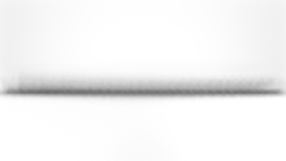
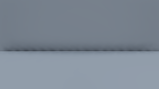

# Ground Truth Ambient Occlusion (slice 5E.5)

Status: implemented (2026-10-22), with Debug/Release and software Vulkan verification.
Target-GPU performance and live windowed review remain pending. See [roadmap](rendering_roadmap.md).

## Contract and ownership

`GtaoSettings` selects Off (default), Half, or Full and a 0.1–5 m radius (default 1 m).
`VulkanGtao` owns two frame slots of compute resources, descriptors, constants and
queries. Renderer owns source depth and its transitions. GTAO forces the same complete
opaque/masked prepass used by Hi-Z in all visibility modes; transparent surfaces neither
write AO depth nor receive opaque-background visibility. Wireframe disables GTAO.
Sampled D32 support is independent of optional Hi-Z/indirect capabilities.

The shader core adapts Intel's MIT XeGTAO horizon integral, edge-aware geometric normal
reconstruction and weighted depth filtering (upstream archived revision `a5b1686`;
[license and adaptation notes](../third_party/xegtao/README.md)). Only the adapted algorithm is included;
no upstream application/framework dependency. Full is the spatial reference. Both
modes use three slices, three samples per side, fixed spatial noise and a single 5x5
edge-aware spatial filter. The retained reference heuristics use radius multiplier
1.457, falloff range 0.615, sample distribution power 2, visibility power 2.2,
and mip offset 3.3; thin-occluder compensation remains zero. [Slice 5G](rendering_temporal_post.md) supplies projection jitter and temporal sample rotation only while effective TAA resolves the shaded result. TAA-off and diagnostic paths keep fixed samples. No independent AO history, micro-normal input, bent
normals, specular occlusion or GI is introduced.

Half uses ceil(native extent / 2), selecting the nearest valid depth in each 2x2
footprint and retaining its offset. Geometric normals use native depth at that exact
pixel. Fine horizon taps read native depth at their actual slice positions: using
a neighbouring half representative for these taps caused false plane self-occlusion
and was rejected by the Full/Half reference test. Coarser taps use the AO pyramid.
A separate FP32 view-depth pyramid has at most five levels and depth-aware
weighted filtering; conservative reversed-Z minimum Hi-Z is never an AO input.
Odd tails are included and sky depth is zero/invalid rather than a distant occluder.
Sampling is bounded to 128 native pixels and visibility smoothly fades to one at
100–200 m and projected radii of 4–1 native pixels. Missing offscreen samples cannot
create occlusion and reduce confidence. Half reconstruction rejects depth/normal
mismatches and defaults to unoccluded when no valid surface sample exists. Normal
reconstruction also reports uncertainty when no reliable adjacent triangle survives;
these silhouette pixels remain unoccluded instead of inventing a view-facing normal.

Shared lighting takes explicit screen visibility and uses min(material AO, GTAO)
for environment diffuse only. This avoids multiplying potentially overlapping crevices
because material assets currently have no spatial AO scale metadata. Sun, local lights,
environment specular, emissive and unlit shading remain unchanged. AO diagnostics
bypass exposure/tonemapping and are composed before UI.

## Resources, synchronization and budgets

### Performance correction (2026-10-22)

Live terrain review found negligible AO contribution but substantial cost at native
resolution. Off is now the default, including initial renderer resource allocation.
The 5x5 filter retains its two reciprocal edge paths and Gaussian weights, but caches
its 12x12 input tile (8x8 output plus a two-pixel halo) in 2,884 bytes of group shared
memory. Horizontal and vertical path products are factored instead of repeatedly
walking each path. This trades bounded shared memory and two group barriers for
fewer texture reads and repeated calculations.
Uniformly white tiles bypass edge filtering. All threads participate in tile barriers,
including out-of-bounds threads in partial groups. Sky output stays white.

Resolve checks distance/projected-radius fade before normal reconstruction or Half
upsampling. Full white visibility and Half footprints containing only white taps
also bypass normals. Raw, normal and edge diagnostics take dedicated paths and
remain available beyond the lighting fade.
Filtering retains active neighbours across the fade boundary rather than discarding
them solely from the centre depth. Image ownership, descriptors and dispatch count
remain unchanged; the tile is shader scratch, not another persistent image.

Regression checks compare against an independent CPU filter over GPU raw/edge data
(including odd extents and group boundaries), existing ray/contact and lighting tests,
mixed fade depths at maximum radius, and far geometry diagnostics. The timing probe
now includes a distant fixture for before/after near and far workloads. Software
timings are only local evidence; RTX 3060 timing remains a separate hardware check.

### Persistent resources

Resources are created only at startup/resize/explicit resolution changes, using the
existing blocking recreation boundary. Ordinary frames reuse their slot after its
existing fence. Off skips all AO dispatches and does not force depth work. A permanent
white texture remains descriptor-valid while disabled.

Working images: R32 float depth with up to five mips; raw AO, edge mask and filtered
AO in R8 UNORM; representative offset in R8 UINT. If extended storage formats are
unavailable, use R32 float / R32 uint equivalents. A native RGBA8 result carries final
visibility or an explicitly selected diagnostic (raw AO, normals, edges); the extra
channels avoid allocating a separate debug-only image or requiring another draw pass.
Only the selected working resolution is allocated. Two frames' driver-reported image
requirements plus the permanent white texture count toward the configurable 512 MiB budget.
The white fallback remains allocated even below the minimum viable budget. Constants
are a 64-byte push block; descriptor/query storage is fixed. No per-frame host arrays
or upload buffers are needed. Exceeding
the budget disables AO with a visible reason. Invalid settings are rejected; unsupported
formats disable the feature. `forceNoGtao` and `forceWideGtao` provide diagnostic
capability/format fallbacks. Actual allocation errors propagate instead of masking device
failures. No unbounded growth, frame-path readbacks, waits, or async compute are added.

Renderer transitions depth writes to compute reads once, runs optional Hi-Z and GTAO,
then restores attachment access. Explicit dependencies cover every filtered mip,
horizon output, denoising, reconstruction and fragment reads. Only fence-safe frame
descriptors are updated. Completed timings distinguish preparation, evaluation and
filter/reconstruction; shared prepass cost is reported separately. Blocking snapshots
are diagnostics, never rendering inputs.

## Verification strategy

Owned small fixtures exercise planes, corners, crevices, thin ridges, masks, silhouettes,
sky, transparency, mode/extent changes, capability/budget fallback, Direct/Indirect/Hi-Z,
fixed/bindless material paths, camera cuts/rebasing and terrain refinement. Independent
cosine-weighted CPU ray samples validate interior regions under the documented visible
height-field assumption (mean absolute AO error <= 0.10); Half vs Full interior mean
error target is 0.05. No equality is assumed at uncertain silhouettes/offscreen surfaces.
Lighting-isolation tests protect direct, specular, emissive and transparent contributions.
Existing baseline fixtures explicitly disable AO where their contract predates it.

A separate probe records captures and median/p95 costs for Off, Off+prepass, Full and
Half at 1080p/native resolution, plus software-sized smoke runs. Debug/Release, SPIR-V
and synchronization validation establish correctness. Target GPU frame-time, allocation
profiling and live motion review are separate gates; keep the RTX 3060 120 FPS / 8.33 ms
objective and terrain generation headroom. Unavailable checks remain pending.

## Controls and reproduction

The terrain window exposes **GTAO: Off / Half / Full**, world-space radius, and
**AO view: Shaded / Visibility / Raw / Normals / Edges**. AO is Off by default.
A mode change deliberately recreates AO resources after submitted work finishes;
radius and diagnostic changes only update push constants. The effective mode and
fallback appear next to completed (two-frame-latency) pass timings and allocated bytes.
Diagnostics are displayed before UI without exposure or a display transform.

`readGtaoSnapshot()` blocks and returns native RGBA visibility/diagnostic pixels,
working depth, raw/filtered visibility, packed edges and representative offsets.
A snapshot requires a successfully rendered active AO frame. Stored raw/filtered
visibility precedes the explicit native-pixel distance/footprint fade.

```sh
cmake --build cmake-build-release --target engine gtao_probe gtao_gpu_tests
cmake-build-release/gtao_probe /tmp/gtao-1080 --require-validation
cmake-build-release/gtao_probe /tmp/gtao-native --width 3840 --height 2160 --require-validation
cmake-build-release/gtao_probe /tmp/gtao-terrain --streaming --require-validation
cmake-build-release/gtao_probe /tmp/gtao-far --far --require-validation
# Software Vulkan correctness / instrumentation smoke; not a target-GPU benchmark:
VK_DRIVER_FILES=/usr/share/vulkan/icd.d/lvp_icd.json cmake-build-release/gtao_probe /tmp/gtao-quick --quick --frames 8 --require-validation
```

The probe compares Off, Off+prepass, Full and Half over identical deterministic paths,
with 16 warm-up frames per mode. `--wide` forces the R32 intermediate formats.
`--streaming` uses owned procedural flat/relief terrain and a 120-second settling
deadline, then follows sampled terrain height. Height readback and all captures occur
outside measurement. Default fixtures are generated plane/corner meshes; `--far` scales both geometry
and camera distances by 1,000 to preserve coverage beyond the AO fade (exclusive
with `--streaming`). Captures
include final colour, visibility, raw AO, linear depth, normals and edge diagnostics.
CSV timings separate shared depth, AO preparation/evaluation/filtering and total scene
cost; timestamp availability is explicit. CPU measurements include frame-fence waiting.

## Limitations and remaining gates

GTAO sees only current depth: hidden/offscreen surfaces and transparent occluders are
not recovered. Finite spatial sampling can shimmer with TAA off; slice 5G rotates samples and resolves shaded HDR when TAA is enabled. Full and Half
can differ around narrow features and disocclusions. There is no GI handoff or distant
occlusion beyond environment irradiance. Material AO scale separation remains a
conservative minimum rule until assets carry scale information.

Target-GPU 1080p/native performance, renderer-wide allocation profiling and live
windowed motion review require functioning hardware. The NVIDIA driver in this
execution environment cannot communicate with the GPU; software timing is not a
claim about the RTX 3060 8.33 ms target. Engine-owned AO frame bookkeeping is fixed
storage by inspection; driver-wide zero-allocation behaviour is not claimed.

## Performance correction verification (2026-10-22)

- Focused GTAO CPU/GPU, visibility GPU and lighting GPU checks: **4/4 Debug**
  (42.65 s) and **4/4 Release** (37.37 s), with software Vulkan synchronization
  validation and no validation errors. These reruns cover the correction; the full
  suite results below belong to the initial implementation.
- All ten GTAO SPIR-V modules validate in both builds. Engine binaries rebuilt in
  Debug and Release. Compact and wide-format filter outputs match the independent
  scalar reference within one half R8 quantisation step plus floating-point tolerance.
- **56 before/after captures are pixel-identical**, including shaded output, final
  visibility, raw visibility, depth, normals and edges for near and distant fixtures.
- Release llvmpipe, 320x180, 16 warm-up and 32 measured frames per mode, validation
  enabled. The distant fixtures scale geometry and camera position together by
  1,000, preserving substantial screen coverage beyond 200 m. Timings below are
  median **total scene GPU time**, including prepass and AO, not isolated AO cost.

| Fixture | Full before | Full after | Half before | Half after |
| --- | ---: | ---: | ---: | ---: |
| Plane | 5.145 ms | 2.662 ms | 2.823 ms | 2.097 ms |
| Corner | 6.593 ms | 2.970 ms | 3.262 ms | 2.365 ms |
| Distant plane | 4.578 ms | 1.903 ms | 2.689 ms | 1.631 ms |
| Distant corner | 5.239 ms | 2.096 ms | 2.902 ms | 1.800 ms |

Image allocations are unchanged: 1,543,424 bytes Full, 764,160 bytes Half and 256
bytes Off on this driver. Off now applies from startup. These software measurements
show reduced work in the exercised fixtures; they do not establish native-resolution
RTX 3060 performance. Depth preparation and evaluation still dispatch when AO is
enabled, even if the final visibility is white.

CSV files retain Off/Off+prepass comparisons, medians/p95, CPU times and allocation
data: [near before](measurements/rendering_5e5/performance_near_before.csv),
[near after](measurements/rendering_5e5/performance_near_after.csv),
[distant before](measurements/rendering_5e5/performance_far_before.csv) and
[distant after](measurements/rendering_5e5/performance_far_after.csv).
Matching `_metadata.txt` files record device, build, settings and validation.

## Initial implementation verification (2026-10-22)

- Debug regression: **26/26 passed**, 268.25 s. Release regression: **26/26 passed**, 238.52 s.
- Final focused reruns pass **2/2 Debug** (25.73 s) and **2/2 Release** (23.24 s),
  including independent ray/geometry depth reconstruction and budget recovery based
  on measured driver allocation requirements rather than software-specific alignment.
- All **21 affected SPIR-V modules** validate in Debug and Release.
- Vulkan synchronization validation uses llvmpipe (LLVM 23.1.3), explicitly selecting
  its ICD because the installed NVIDIA driver cannot communicate with hardware.
- The ray reference uses 2,048 deterministic cosine-weighted samples at each of 39
  interior floor-contact pixels, radius 1 m. Full AO mean absolute error is **0.03672**
  (compact) / **0.03682** (wide). Half versus Full is **0.00704** / **0.00744**, below
  the 0.10 ray-reference and 0.05 resolution-comparison thresholds. These fixtures
  establish local integration quality, not a global screen-space error bound.
- GPU checks cover native depth / half representative agreement (including odd tails
  and FP32-rounded ties), open-plane silhouette visibility >= 0.95, same-frame removal,
  alpha-mask holes, transparent contribution isolation, authored AO overlap, direct/
  specular/emissive/unlit isolation, visibility modes, forced-wide/fixed-material and
  independent no-HiZ paths, unsupported/budget fallback and resize recovery, one-pixel
  extents, cuts/rebasing, far fade, exposure-independent diagnostics, and fixed/streamed
  terrain morph/refinement. Submitted mesh/material readers survive resource release.
- No validation errors are accepted. CPU tests also cover extent/settings validation,
  projection/depth reconstruction, radius/distance fade boundaries and monotonicity.

### Software probe evidence

Release 320×180 runs completed with synchronization validation, 16 warm-up frames per
mode, eight measured frames for plane/corner fixtures and four for streamed flat/relief
terrain. This small sample verifies instrumentation and captures, not stable throughput
or the target GPU's frame budget. Native/1080p hardware measurements remain pending.
The following numbers are median **total scene GPU time**, including depth and AO:

| Fixture | Off | Off + prepass | Full | Half |
| --- | ---: | ---: | ---: | ---: |
| Owned plane | 0.767 ms | 1.063 ms | 5.109 ms | 2.855 ms |
| Owned corner | 1.039 ms | 1.209 ms | 6.825 ms | 2.993 ms |
| Streamed flat terrain | 2.750 ms | 3.606 ms | 8.483 ms | 6.218 ms |
| Streamed relief terrain | 2.940 ms | 3.568 ms | 9.038 ms | 5.901 ms |

AO image allocation was **1,543,424 bytes Full** / **764,160 bytes Half**, including
both frame slots, native output and the permanent white texture. Off retains only
its 256-byte white allocation. This excludes shared source depth and other renderer
systems. The compact theoretical payload is `2 * (4 * sum(mip pixels) + 4 * working
pixels + 4 * native pixels)` bytes before allocation padding and the white texture;
wide intermediates replace the `4 * working pixels` term with `16 * working pixels`.

Separate pass medians/p95, CPU frame time, allocations and timestamp availability
are retained in [fixture measurements](measurements/rendering_5e5/fixtures.csv) and
[streaming measurements](measurements/rendering_5e5/streaming.csv), with adjacent
metadata files. The Half correction removed false plane self-occlusion while retaining
contact shading; its remaining spatial noise is visible without TAA.





