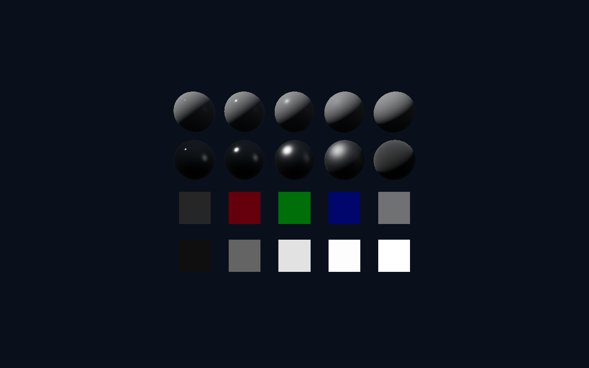
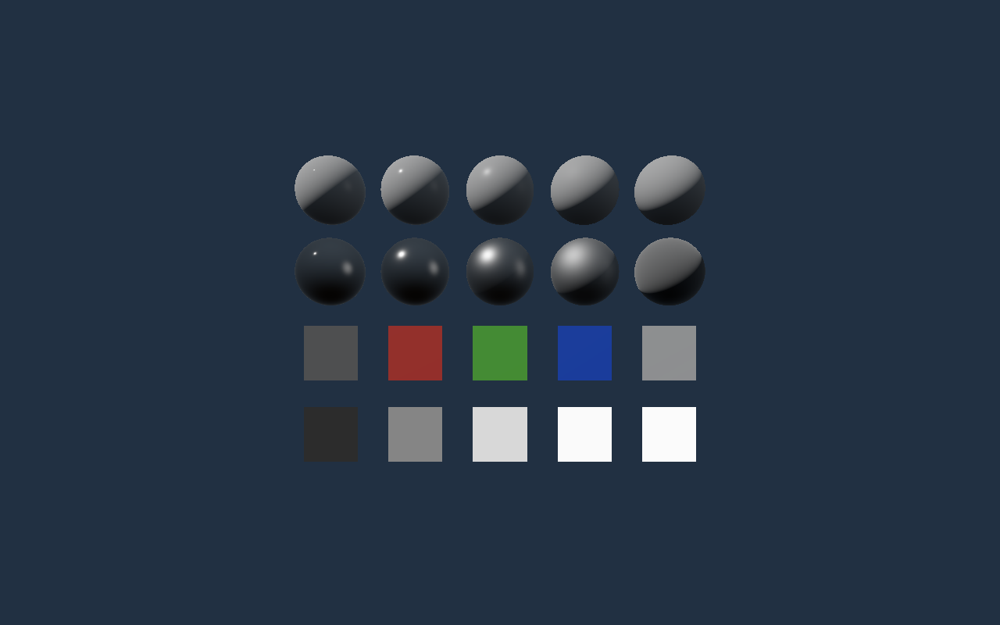
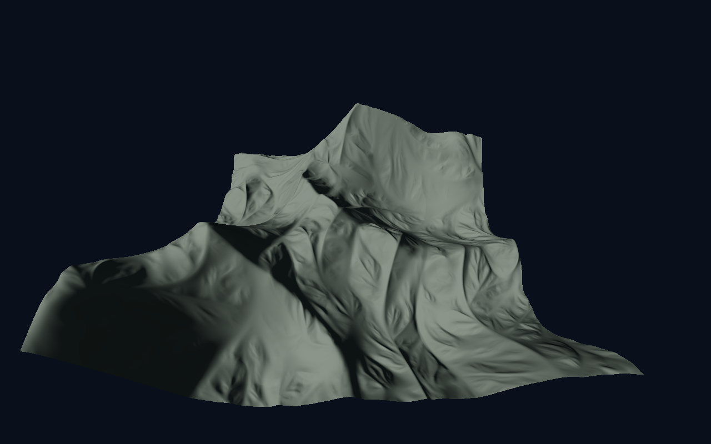

# HDR and shared PBR (milestone 5A)

Status: implemented. Software Vulkan verification is recorded below; target-GPU
performance and live windowed verification remain pending. Implements slice 5A of
[the roadmap](rendering_roadmap.md).

The descriptions and measurements below record the 5A baseline. [Slice 5D](rendering_clustered_lighting.md)
replaces the interactive material preview with ordinary mesh fixtures, removes its uniforms/resources,
and extends the lighting descriptor layout. The 5A colour/BRDF contract and regression swatches remain.

## Colour and lighting contracts

Opaque terrain or the material preview renders into an RGBA16F image, followed
by an output transform into an sRGB target. Working primaries are linear
Rec.709/D65. Lighting calculations use FP32; the scene image stores radiance
multiplied by `2^compensation / (1.2 * 2^EV100)`. Defaults are EV100 15 and
compensation 0. The output pass does not apply exposure again. Pre-exposed values
are limited to FP16's finite maximum, 65504, before storage; extreme exposure or
emission can saturate this limit. [Slice 5G](rendering_temporal_post.md) now rescales linear HDR history by current/previous pre-exposure before resolve.

`SurfaceMaterial` carries base colour, world-space shading normal, perceptual
roughness, metallic, AO, emissive and opacity. Shared lighting implements GGX,
height-correlated Smith visibility, Schlick Fresnel and energy-weighted Lambert
diffuse. Roughness is clamped to 0.045–1; base colour, metallic and AO to 0–1.
Terrain defaults to linear colour (0.40, 0.46, 0.38), roughness 0.8 and metallic 0.
Filtered terrain normals retain their existing Y-up convention; interpolated
camera-relative positions supply the view direction. AO affects indirect diffuse
only. Single-scattering GGX loses some energy at high roughness; multiple-scattering
compensation is outside this baseline. Opacity is reserved for later material
consumers; this slice draws opaque surfaces.

The unshadowed sun defaults to white, 100000 lux, in direction
`normalize(-0.6, 0.8, 0.35)` **towards** the sun. A zero direction falls back to
up. Sun intensity is bounded to 200000 lux. The owned analytic environment blends
a blue upper hemisphere into a darker ground hemisphere with a broad studio
reflection lobe, without a solar disk. Its upper-hemisphere colour has unit
luminance before the lobe. Brightness defaults to 3000 nits, bounded to 20000;
rotation is around Y. Emissive RGB is linear radiance, bounded to 1e6 per channel.
Non-finite material/lighting inputs are rejected; finite controls are clamped.

A deterministic startup CPU bake creates:

- A 64×64 cubemap with seven GGX roughness levels, 128 Hammersley samples per
  filtered texel. Mip zero evaluates the analytic field directly.
- Nine diffuse SH coefficients, weighted by cube solid angle and convolved with
  the cosine kernel; the lighting shader applies the Lambert `1/pi` exactly once.
- A 128×128 split-sum BRDF LUT using 256 samples per texel and correlated Smith
  visibility, matching the direct-light model.

Diffuse and specular sample the same rotated environment. This supplies controlled
ambient/reflection lighting, not local bounced GI or a physical visible sky.
The existing solid background remains a synthetic pre-exposed debug backdrop:
it passes through the selected output transform but does not change with exposure.

ACES fitted is the default Stephen Hill/BakingLab approximation, without an
additional brightness boost. AgX neutral is adapted from Filament, including
Rec.709↔Rec.2020 primary conversion. Neither is the complete ACES 2 or Blender OCIO
pipeline. Both return display-linear RGB; the sRGB attachment performs the sole
output encoding. Licence notices accompany both adaptations in
`third_party/rendering/`.

ImGui renders after the output transform, without scene exposure. Its custom
fragment shader decodes authored style/font RGB into display-linear values before
alpha blending on the sRGB target. Alpha stays linear. This contract currently
covers the UNORM font atlas and authored UI colours; future UI image resources
must respect this encoding contract.

## Ownership, interfaces and bounded storage

[Independent scene resolution](rendering_resolution.md) extends the baseline
below: each frame slot owns scene-sized HDR and depth attachments, independently
of presentation targets. The output pass scales HDR before tone mapping and draws
ImGui at native output resolution. Scene pipelines survive presentation resizing;
scene attachments change only when the effective render extent changes.

`lighting.hpp/.cpp` owns settings, GPU uniform layout, the immutable CPU fixture
and CPU reference functions. `lighting.hlsli` owns shared surface lighting.
`Renderer` owns the Vulkan lighting resources, HDR/output passes, preview geometry
and timings. Terrain generation, persistence and cache identity are unchanged.
Terrain graphics layouts borrow lighting descriptor layout **set 1**, while terrain
set 0 and compute resources retain their existing ownership.

Each of the two in-flight frame slots owns an HDR image/view, output descriptor,
lighting descriptor and persistently mapped 384-byte uniform buffer. Set 1 contains
the uniform, environment cube, BRDF LUT and sampler. The renderer owns one immutable
copy of the two environment textures, a sampler, generated sphere/quad geometry,
three graphics pipelines (terrain, preview, output) and an optional six-query
render timing pool. Temporary upload storage is released after startup completion.
The CPU bake is shared across renderer instances in a process; Vulkan resources
are independently owned. CPU bake storage is about 0.75 MiB and geometry/upload
scratch is bounded by the fixed fixture dimensions.

Uniform and timestamp reuse follows each slot's fence. The HDR attachment
transitions from colour writes to fragment sampling before the fullscreen output
pass. Resize uses the existing device-idle recreation boundary; descriptors are
updated only after old work has retired. Ordinary lighting updates add no host
readback, allocator traffic or additional waits. Resource exhaustion fails with a
Vulkan error; it does not grow a hidden cache or downgrade colour formats.

The HDR target requires colour-attachment, sampled-image, linear-filter and
transfer format support. Presentation requires an sRGB BGRA8/RGBA8 surface; unsupported
surfaces fail explicitly. Offscreen output uses the same shaders and an RGBA8 sRGB
target. `RendererOptions::width/height` and `resizeOffscreen` allow owned small
fixtures; zero or dimensions above 16384 are rejected before allocation (device
limits and available memory can impose smaller limits).
These dimensions now describe output; `renderHeight` optionally chooses a fixed
scene height with width derived from the output aspect. Zero retains native scene
rendering for existing fixtures. HDR readback uses scene dimensions, while captures
use output dimensions.

`readHdrSnapshot()` is an explicitly blocking diagnostic returning RGBA pixels
and that frame's pre-exposure. `capture()` continues to emit display-encoded PPM.
`renderingStats()` reports actual HDR/lighting image and buffer allocation bytes,
completed-slot GPU scene and output-plus-UI timings, and one-time CPU lighting
setup time. Scene timing excludes terrain generation. Setup time includes the
CPU fixture, uploads and preview resources but excludes pipeline creation. These
byte counters exclude driver-internal pipeline/descriptor allocations and the
existing depth/presentation/terrain allocations. Unsupported timestamps are
reported as unavailable; no query waits are introduced.

## Current controls and historical captures

**Lighting & Materials** exposes PBR/Legacy shading, sun/environment, exposure,
ACES fitted/AgX and the slice 5D lighting demo. The former independent preview
camera and `--material-preview` option are removed. The lighting GPU test now
creates its roughness/metallic spheres, colour panels and unlit emissive ramp through
the ordinary mesh API. Hidden-terrain tools retain the last streaming observer.

The following images are historical 5A captures, not a separate current scene mode.







The terrain capture reuses the owned seed-34434 ridge fixture: 512 m square,
world origin (-6656,512), 1 m mesh/0.5 m normals, LOD enabled. It is deliberately
untextured and unshadowed. Texture artwork and mapping belong to slice 5B.

## Verification and measurement

The new `lighting_cpu` and `lighting_gpu` fixtures cover transfer functions,
manual exposure, tone-map reference values and GPU output, bounded/grazing BRDF
response, integrated reflection energy, SH normalization against independent
hemisphere integration, roughness filtering, HDR values above one, sun/environment
isolation and rotation, UI gamma/linear alpha blending/exposure independence,
flat-terrain PBR against the CPU BRDF, diagnostics, invalid input recovery and
repeated offscreen resize. They own all generated geometry, data and temporary
files. The streaming regression additionally checks PBR exposure at a large world
origin and verifies that preview switching preserves terrain residency/generation.
Existing tests that assert legacy shading explicitly select it.

Use Debug and Release with `BUILD_TESTING=ON` and `OPENWORLD_GPU_TESTS=ON`, then:

```sh
VK_DRIVER_FILES=/usr/share/vulkan/icd.d/lvp_icd.json \
  ctest --test-dir cmake-build-debug --output-on-failure
VK_DRIVER_FILES=/usr/share/vulkan/icd.d/lvp_icd.json \
  ctest --test-dir cmake-build-release --output-on-failure
```

Verification on 2026-10-17 used llvmpipe (LLVM 23.1.1) with Vulkan synchronization
validation. Debug: **16/16 passed**, with the final lighting/streaming changes also
passing their focused rerun. Release: **16/16 passed**.
The preview and terrain captures above completed with zero validation errors.

At 1280×800, the two HDR slots consume **15.625 MiB** and lighting/preview GPU
buffers and images consume **0.475 MiB** on this driver. Unpadded HDR storage is
`width * height * 16` bytes (31.64 MiB at 1920×1080); these targets are additional
to existing depth and presentation images. A Release preview run measured roughly
**134 ms** for first-instance lighting initialization. The 60-frame capture's last
completed scene/output samples were 6.42/2.00 ms for ACES and 4.70/0.95 ms for AgX.
These software-driver samples are instrumentation sanity checks, not comparative
benchmarks or evidence that AgX is faster: concurrent test work and scheduling
were uncontrolled.

There is no accessible hardware GPU or display server in this environment.
Windowed presentation, resize/minimize/restore and interactive collapse still
need a live run. The same output/UI pipelines are exercised offscreen. The
RTX 3060 **120 FPS / 8.33 ms** objective remains pending measurement at 1080p and
native resolution, with steady-state median/p95 CPU/GPU times, spikes and memory
recorded separately from startup and terrain generation. No target-GPU performance
improvement is claimed.

## References

- [Filament PBR](https://google.github.io/filament/main/filament.html)
- [Stephen Hill ACES fitted implementation](https://github.com/TheRealMJP/BakingLab/blob/master/BakingLab/ACES.hlsl)
- [Filament AgX implementation](https://github.com/google/filament/blob/main/filament/src/ToneMapper.cpp)
