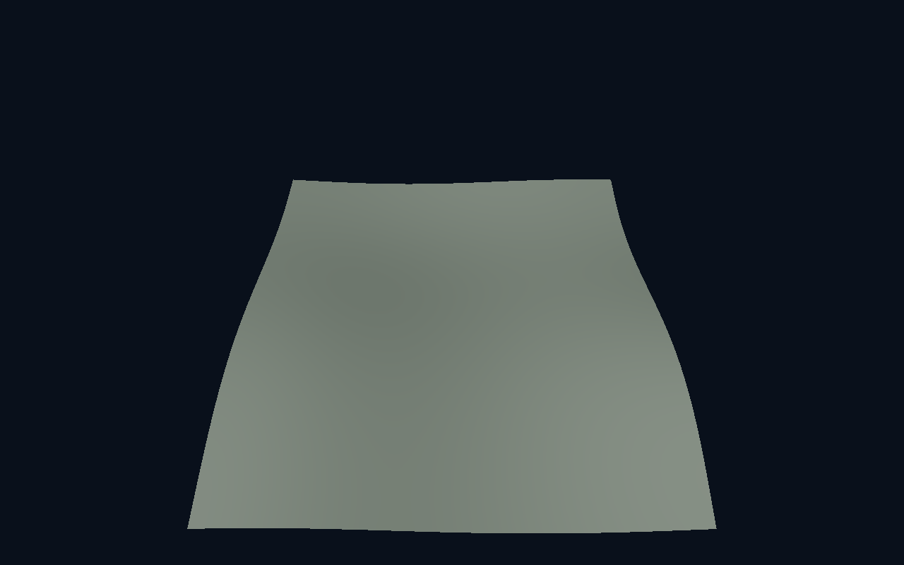
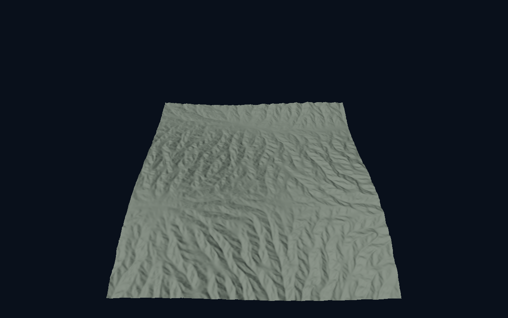
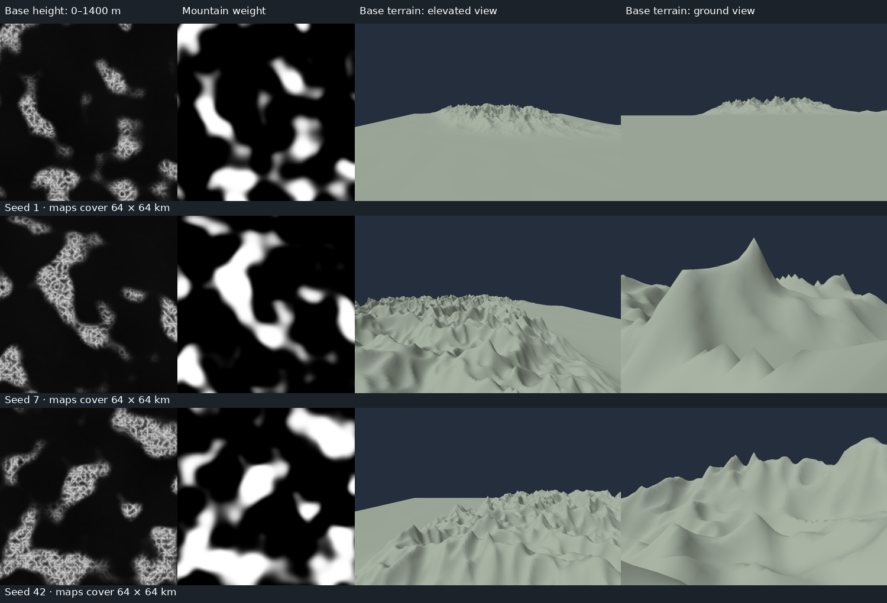

# Regional terrain geography

Status: implemented. Replaces the uniform four-octave base generator. Software
Vulkan correctness and regional visual review are verified; target-GPU performance
and live desktop input remain unverified. The full-size software cold-flight
probe exceeds its default 60-second settling deadline; details below.

## Responsibilities and algorithm

### Adjustable base smoothness

Status: implemented; verification results below. `TerrainSettings::ridgeStrength` and
`baseDetail` are finite values in [0,1], defaulting to 0.50 and 0.65 respectively. The Base Terrain
Generation window applies edits on release. Ridge strength blends rounded hills
into the previous ridged mountain shape; base detail controls the local octave
weights `1,q,q²,q³`, where `q=0.5*baseDetail`, normalized by their sum. Regional
elevation and mountain distribution do not change. Smooth mountain relief is the
square of the normalized hills field (`0.5 + 0.5*localNoise`); strength one uses
the existing squared ridged multifractal. Both controls at one reproduce the
previous base and erosion-driving functions.

The erosion driver uses the same controls but only the first two octaves, with
normalization `1+q`, wider ridge rounding and no ridge feedback. Its blended
relief supplies the peak/valley target. Analytic gradients propagate through all
operations. Material slope classification receives the same settings and retains
its smoother feedback treatment. Final normals still come from final heights.

Settings occupy reserved `geography.yz` lanes; the CPU/HLSL parameter block stays
496 bytes. Request equality and cache identity include both controls. Cache
format 3 appends the settings within the existing 128-byte identity header; old
disposable caches miss and regenerate. Ownership, resources, synchronization,
noise domains and bounded scheduling are unchanged. There are no new noise
samples or neighbouring-sample blur passes. At zero base detail the shader skips
the three unused local noise octaves using a uniform branch.

Verification covers validation and transactional edits, parameter packing,
independent cache invalidation, gradients, finite outputs, repeatability, signed
and distant shared edges, and zero-height/erosion identities at smooth,
intermediate and legacy settings. Historical shape-dependent regressions select
both controls at one explicitly. Small mountain fixtures compare short-scale
curvature and retained broad relief. Offline probe switches `--ridge-strength`
and `--base-detail` allow identical-view base/eroded comparisons.
`terrain_generation_probe CHUNK_X CHUNK_Z RIDGE_STRENGTH BASE_DETAIL` reports
streaming generation timings and allocated storage for either endpoint.
Historical measurements below describe the previous (1,1) shape, not the new
adjustable startup settings.

### Regional structure and legacy shape

The following four-octave/ridged description applies to sliders (1,1); the new
smoothness controls modify local relief and its erosion driver as described above.

The [ridge stability and rolling plains follow-up](terrain_ridge_stability.md)
separates erosion's driving slope from fine mountain relief and increases local
plains variation. Its numerical regressions and visual comparison are recorded
separately from the original milestone measurements below.

The existing GPU height evaluators share a pure world-space function. Three
independently salted fields provide regional elevation (two octaves at 2R and R),
mountain distribution (two at R and R/2), and local forms (four at W through W/8).
Amplitudes halve each octave and sums use fixed normalization, never tile extrema.
There are at most eight base noise evaluations (five at zero base detail), plus
up to five erosion octaves per sample.

A quintic smoothstep of the signed distribution field over [0, 0.2] produces m.
Plains, foothills, and mountains have weights (1-m)^2, 2m(1-m), m^2. Plains use
four-octave rolling relief, foothills ordinary fractal noise, and mountains rounded
ridged multifractals with feedback from preceding ridges. Rounding width is 0.02.
Squaring mountain relief opens valley floors; feedback suppresses fine detail
where coarse relief is low. Regional elevation is independent of local roughness.
At height scale 1200 m, coefficients are 120 m regional elevation, 50 m plains,
120 m foothills and 1200 m mountains. All scale proportionally; zero height is flat.

Value-plus-gradient arithmetic propagates product/chain rules, including blending
weights and feedback. An internal BaseTerrainSample returns metres, world-space
height gradient, mountain weight, and a separate erosion-driving gradient/target. Final rendering
normals still use sampled final heights, not erosion's approximate derivatives.

The erosion adapter converts a smoother two-octave world slope to the filter's
normalized coordinates, preserving sharp base mountains without feeding their
fine gradient changes into erosion direction.
Its wavelength is independent, default 1024 m; amplitude reference is heightScale/3
(400 m by default). Fade target comes from the smoother driving relief. Displacement is
multiplied by m, protecting pure plains. Zero strength returns identical variants.
Warping, rivers, regional simulation, materials and vegetation are deferred.

## Interfaces, coordinates, and storage

TerrainSettings retains wavelength (now mountain wavelength, default 2048 m),
heightScale (default 1200 m), seed, erosion strength and rounding. Geography fields:
regionWavelength=16384 m (4096..65536), erosionWavelength=1024 m (64..8192),
ridgeStrength=0 and baseDetail=0 (both 0..1).
Settings equality and cache identity include all fields. Cache representation
identities use format 3 with the existing representation IDs; old disposable
caches are misses, not migrated.

TerrainParameters owns a fixed array of 13 noise domains (4 local, 2 elevation,
2 distribution, 5 erosion) and an additional 16-byte geography row. Domain lattice
padding holds a fixed field salt. The CPU/HLSL parameter layout is 496 bytes, checked statically.
Canonical integer quarter-metre addressing, negative floor decomposition and
32-bit lattice range validation apply to all domains. No absolute float world
coordinates, camera-dependent octave selection, or per-tile normalization.

All generated storage remains owned by the existing Vulkan terrain systems.
There are no new resident textures, dependency layers, allocations during updates,
or waits during ordinary frame processing. Existing fences, scratch lifetimes,
bounded workgroup scheduling, and resource retirement remain authoritative.
Extra noise arithmetic can reduce generation throughput; measure rather than
assuming it is free. Camera reset uses a conservative final-height upper bound (1.25 times height
scale). Fixed single-chunk inspection then fits the actual sampled mesh bound
using a blocking snapshot after the first submission; this occurs only at startup
or an explicit reset, never during ordinary navigation.

The blocking `sampleTerrainGeography(grid, request, canonical)` diagnostic returns
owned 32-byte samples containing the production base gradient, height, mountain
weight, erosion peak/valley target, driving gradient and eroded height. It uses a separate lazily
created compute pipeline and existing slot-zero sample storage; no diagnostic
branch is added to production kernels. It rejects streamed/LOD/multi-slot callers
and oversized grids, waits before writing, and invalidates slot zero so the next
normal render restores its requested data. Canonical probes require quarter-metre
spacing; noncanonical probes permit finer convergence studies.

`terrain_probe --geography OUTPUT_DIRECTORY` writes 513x513 maps at 125 m spacing,
raw float32 diagnostic rows, a CSV summary and perspective captures for seeds
1, 7, 42 and 34434, plus 2 km plains samples and elevated/ground captures. These coarse maps are for regional shape review, not fine erosion
sampling validation. The ordinary probe and sampling study cover finer spacing.

## ImGui

Base Terrain Generation contains seed, regional wavelength, mountain wavelength,
height scale, ridge strength and base detail. Both new sliders range from 0 to 1
and default to ridge 0.50 / detail 0.65; tooltips explain their endpoints and the (1,1) legacy shape.
OpenWorld retains erosion controls, rendering/camera controls,
and diagnostics. Both use native title-bar collapse, independent identities,
first-use position/size, resizing and scrolling. Begin's return value guards each
body; End is unconditional. Coalesce setting edits after both windows, outside
visibility blocks. Window manipulation is draw-only; errors appear in either
expanded window. Existing ImGui input capture applies to both.

## Verification

### Smoothness verification (2026-10-17)

Debug and Release builds succeed. All 20 Release checks pass: 19 through CTest,
with the hierarchy GPU test passing in an isolated direct run using a 300-second
outer limit. Earlier simultaneous verification workloads exceeded that test's
120-second CTest limit. The full Debug run passed 18 checks but hit 120-second
limits in detail cancellation and hierarchy; Release detail cancellation passed
in 85 seconds. After the zero-detail octave optimization, all six focused Debug
checks pass (CPU settings, geography, neighbourhood, terrain rendering, materials
and LOD quality). Completed GPU checks report zero Vulkan validation errors.
Software verification uses `VK_DRIVER_FILES=/usr/share/vulkan/icd.d/lvp_icd.json`
and `LP_NUM_THREADS=8`; two-worker runs were also tried but exceeded the long-test
deadlines. These timing limits were not weakened in CMake.

An isolated Release generation spot check at chunk (20,20), with disk cache off,
128 m tiles and a target of three detailed tiles, recorded the following. Both
runs used eight llvmpipe workers, validation and the same 415.748 MiB GPU storage.

| Ridge/detail | Completed compute time | Time to three detailed tiles | Dispatches |
| --- | ---: | ---: | ---: |
| 0/0 | 727.8 ms | 5.95 s | 1369 |
| 1/1 | 810.5 ms | 5.90 s | 1436 |

This is a single scheduler/generation spot check, not a frame-rate benchmark or
an RTX 3060 result. Adaptive dispatch counts differ; reduced noise arithmetic
does not establish a general end-to-end speedup. Reproduce with
`terrain_generation_probe 20 20 0 0` and `terrain_generation_probe 20 20 1 1`.

Owned 2 km mountain patches for seeds 1, 7 and 42 retain approximately 205, 266
and 476 metres of base relief at (0,0). Their summed squared second differences
at 16 m spacing are respectively 0.000212, 0.000316 and 0.000786 times those at
(1,1), confirming reduced short-scale curvature without removing broad relief.
Raising base detail independently increases curvature for either ridge endpoint.
The same tests cover intermediate settings and analytic gradients. The historical
crease and ridge regressions retain their original thresholds with explicit (1,1)
settings. A before/after binary probe at world (2640,2640) differed by at most
0.00025 m in base height and 0.00037 m in eroded height at (1,1); the function is
preserved within floating-point compilation differences, not bitwise across builds.

Offline captures cover all four slider extremes for the three seeds, using
256×256 cells at 8 m spacing, default erosion and identical elevated cameras
(reference height 600 m). Patch coordinates are (10,31), (10,10) and (30,21).
The images show broad smooth base slopes and erosion-added structure. They are
shape comparisons, not a near-ground sampling-quality test.




Reproduce a comparison with:

```sh
VK_DRIVER_FILES=/usr/share/vulkan/icd.d/lvp_icd.json LP_NUM_THREADS=8 \
  cmake-build-release/terrain_probe /tmp/smooth.bin 256 8 10 31 .3 1 1 capture 600 \
  --ridge-strength 0 --base-detail 0
```

Target-GPU timing and live UI drag/release review remain unverified in this
environment. Vulkan uses llvmpipe; the NVIDIA ICD cannot load here.

Small owned fixtures cover validation, coalescing, cache invalidation, zero-height
and zero-erosion identities, repeatability, signed/distant coordinates, shared
mixed-resolution samples and normals. Compare production analytic gradients to
central differences on quarter-metre sample positions, with curvature-aware
absolute/relative tolerances. Preserve crease/lighting regressions by selecting
fixtures that actually contain mountain terrain.

A separate offline probe samples production height/gradient/mountain-weight maps
across 64x64 km for seeds 1,7,42 and records base/eroded perspective views. Inspect
plains, foothills, mountain groups, valley floors and LOD transitions. Compare
cold generation and large-view streaming against the old Release baseline, with
Vulkan synchronization validation. Manually inspect independent window collapse,
resize, scroll, edit-on-release, errors and input capture where a display exists.
RTX 3060 results must not be inferred from software Vulkan.

## Original milestone results (2026-10-16, before the ridge follow-up)

- All 14 CTest cases pass in Release and Debug (including a focused rerun after
  adding the valley-floor gradient fixture). Vulkan synchronization validation
  reported zero errors. Gradient checks cover plains, blend zones, mountain slopes,
  crests and low mountain relief; tolerance is 0.002 plus 2% of the finite-difference
  slope, allowing float subtraction and curvature over a 0.5 m stencil.
- Existing shared-height, mixed-resolution normal, generation-order, cache,
  streaming pressure and lifetime tests pass. The hierarchy movement fixture now
  pre-samples its path and follows the terrain without introducing blocking
  queries during movement; otherwise the steeper geography exposed the outer
  coverage edge rather than testing internal seams. The cache integration fixture
  reads format-2 payload length at its new offset, with a bound before allocation.
- The erosion sampling regression uses the owned 16 m mountain patch at chunk
  (165,165); no production assets are involved. The sampling-study tool now uses
  the regional defaults and mountain patches, while the previous study remains
  explicitly historical.
- Offscreen ImGui mouse-event rehearsal verified independent collapse/expand,
  both collapsed heights below 30 pixels, dragging, resizing, and exactly one
  regeneration for a released mountain-wavelength edit while OpenWorld was
  collapsed. Manipulating windows did not regenerate terrain. The ordinary
  offscreen UI capture and rehearsal had zero Vulkan errors. No accessible X
  connection was available for manual SDL mouse/keyboard capture verification.

### Landscape evidence



Each map covers 64x64 km at 125 m samples. Perspective previews use a 16 km patch
with 32 m mesh spacing; their coarse silhouettes are not near-player mesh quality.
The rightmost views place the camera 3 m above the sampled surface. All images in
this comparison show the base terrain, without erosion.

| Seed | Plains (weight < 0.01) | Mountains (weight > 0.99) | Highest sampled base terrain |
| --- | ---: | ---: | ---: |
| 1 | 61.9% | 5.8% | 1270 m |
| 7 | 62.3% | 7.8% | 1260 m |
| 42 | 46.9% | 14.8% | 1259 m |

Remaining area forms transitions/foothills. Mean sampled plains slope is about
0.0032 m/m; pure mountain regions average about 1.06–1.09 m/m. These seed-specific
measurements are visual tuning evidence, not guarantees for every seed.

### Performance evidence

Release, llvmpipe LLVM 23.1.1, synchronization validation enabled. The isolated
256-cell cold-generation probe excludes drawing and ends after three fine-detail
products publish:

| Generator/location | First detail | Third detail | Frames to third detail |
| --- | ---: | ---: | ---: |
| Previous uniform generator, chunk (0,0) | 0.265 s | 0.414 s | 261 |
| Regional plains, chunk (0,0) | 0.134 s | 0.280 s | 284 |
| Regional mountains, chunk (20,20) | 0.495 s | 1.262 s | 335 |

These are uncapped single runs, not 120 FPS measurements. Plains skip erosion;
mountain arithmetic is materially more expensive. The mountain row samples a
new location and is not a controlled same-location speedup comparison. Profile
the RTX 3060 before drawing target-hardware conclusions.

A separate matching old/new streaming workload uses 32-cell chunks, radius 128
(2.048 km outward), cold/warm starts, teleports and a 100 m/s flight. Cold complete
fill including the probe's quiet period changed from 14.76 s to 14.11 s. Warm
flight p50/p99 changed from 5.03/5.87 ms to 4.79/5.60 ms. Terrain content and visible
triangles differ, so this is an end-to-end comparison, not isolated shader cost.
Managed GPU storage stayed fixed at 45.4954 MiB (previously 45.4951 MiB), managed
host storage at 32.5821 MiB, with zero cache/validation errors. Warm initial fill
regenerated zero products. Software-driver first-draw spikes around 140 ms remain.

A full-size cold-start flight at 256 cells and radius 128 (16.384 km outward)
**failed the default 60-second settling deadline**. Diagnostic reruns with a
180-second deadline confirmed continued progress and eventual completion:

| Cold trajectory | Flight p50 / p99 | Settling time after stopping | Nearby detail ready during flight |
| --- | ---: | ---: | ---: |
| 100 m/s | 5.54 / 9.58 ms | 75.93 s | 0% |
| 400 m/s | 5.42 / 11.94 ms | 74.46 s | 0% |

Each flight runs three seconds forward and three seconds backward from an empty
cache. The low early frame times include incomplete coverage and must not be
interpreted as fully populated rendering performance. In the 100 m/s run, coverage
grew from 91 tiles at 10 seconds to 150 at 60 seconds; both runs eventually reached
191 coverage tiles, 34 detail residents and all nine nearby detail tiles. Explicit
allocation stayed fixed at 442.745 MiB GPU / 44.4928 MiB managed host, with zero
Vulkan validation errors. This establishes a software-generation throughput
limitation rather than a stuck residency queue. Extended-deadline completion does
not satisfy the original deadline. Neither run exercises near-detail cancellation
during motion because nearby coverage arrives after movement has stopped; the
dedicated cancellation tests remain the relevant correctness evidence.

Reproduction (use fresh directories for cold runs):

```sh
VK_DRIVER_FILES=/usr/share/vulkan/icd.d/lvp_icd.json ./cmake-build-release/terrain_probe --geography /tmp/geography-review
VK_DRIVER_FILES=/usr/share/vulkan/icd.d/lvp_icd.json ./cmake-build-release/terrain_generation_probe
VK_DRIVER_FILES=/usr/share/vulkan/icd.d/lvp_icd.json ./cmake-build-release/terrain_generation_probe 20 20
VK_DRIVER_FILES=/usr/share/vulkan/icd.d/lvp_icd.json ./cmake-build-release/terrain_hierarchy_probe /tmp/geography-stream 32 128 16384
VK_DRIVER_FILES=/usr/share/vulkan/icd.d/lvp_icd.json ./cmake-build-release/terrain_hierarchy_probe /tmp/geography-flight 256 128 16384 3
# Diagnostic only: allow extra settling time on software Vulkan.
VK_DRIVER_FILES=/usr/share/vulkan/icd.d/lvp_icd.json ./cmake-build-release/terrain_hierarchy_probe /tmp/geography-flight-extended 256 128 16384 3 180
```

## References

- [Ridged multifractals](https://libnoise.sourceforge.net/docs/classnoise_1_1module_1_1RidgedMulti.html).
- [Regional blending](https://libnoise.sourceforge.net/tutorials/tutorial5.html).
- [Elevation shaping](https://www.redblobgames.com/maps/terrain-from-noise/).
- [Rune's erosion filter](https://blog.runevision.com/2026/03/fast-and-gorgeous-erosion-filter.html).
