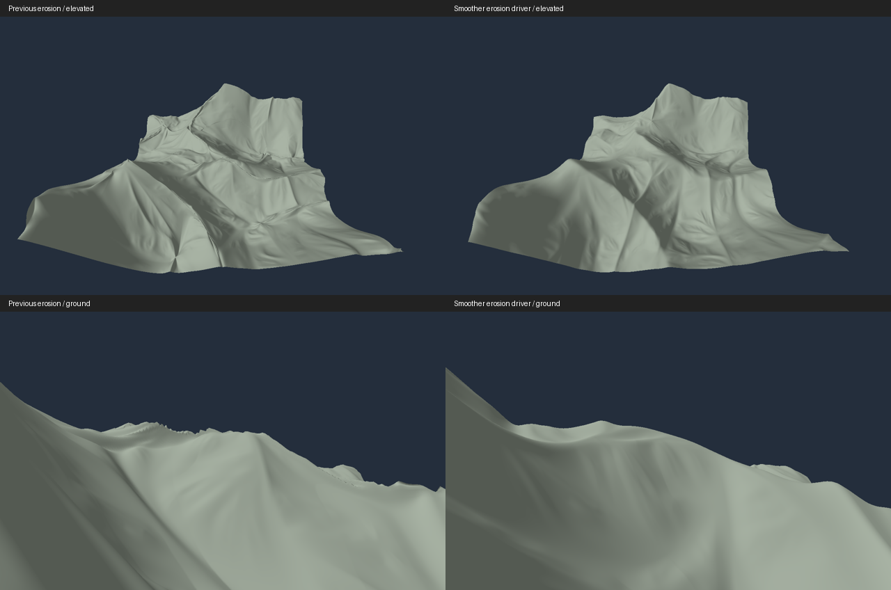

# Erosion ridge stability and rolling plains

Status: implemented and verified on software Vulkan. Target-GPU timing and live
desktop inspection remain unverified.
This follows the [regional geography milestone](terrain_geography.md).

## Finding

Seed 34434 exposed very steep, narrow erosion features even without LOD or
streaming. At world origin (-6496,672), a 16 m patch had a maximum adjacent height
step of 12.08 m on the 0.5 m mesh, while the base's largest step was 0.61 m.
The eroded step fell to 1.71 m at 0.0625 m spacing: this fixture contains steep
continuous features, not evidence of a finite height discontinuity. Raising
crease rounding from 0.3 to 0.6 or 1 did not resolve the problem.

Fine ridged multifractal gradients change direction too rapidly to serve as
erosion's direction field. The filter can amplify those changes into poorly
sampled surface features. This is separate from the earlier gully-rounding issue;
the existing crease-rounding regression is retained unchanged.

## Implementation and ownership

The visible mountain height function retains four octaves, rounding width 0.02,
feedback, and squared relief. Erosion instead uses a separate analytic driving
field constructed from the first two already-evaluated local noise octaves:
rounded ridges of width 0.15, no multifractal feedback, weights 1 and 0.5,
normalization by 1.5, then squared combined relief. Regional elevation and
landform weights remain the same; driving plains and foothills use the same
two-octave local field. This retains broad directional structure without feeding
fine gradient changes into erosion.

`BaseTerrainSample` carries the actual base gradient separately from the driving
gradient. The erosion adapter uses the latter and the smoother peak/valley
target, retaining wavelength normalization, heightScale/3 amplitude and mountain
masking. Final geometry and normals still use the final sampled heights. Base
gradient diagnostics continue to describe the actual base surface.

Plains now use four octaves normalized by 1.875 and multiplied by heightScale/24
(50 m at default height), replacing two octaves and heightScale/120. Actual relief
depends on the noise values; 50 m is a multiplier, not a promised peak-to-valley
range. Regional masks and smooth blending are unchanged. Pure plains remain
protected from erosion, and zero height/zero erosion identities remain intact.

There are no new noise evaluations, neighbouring height queries, resident
textures, GPU allocations, or ordinary-frame waits. Existing GPU ownership,
work budgets and retirement remain authoritative. The blocking geography probe
uses its previously reserved `detail.yz` lanes for the driving world gradient;
`detail.x` is now the driving peak/valley target. Its record remains 32 bytes.
Cache format stays 2; fixed/hierarchical generator representations become 3/6,
so old disposable products miss and regenerate. No new UI controls are added.

## Numerical and visual evidence

All figures below use llvmpipe with Vulkan synchronization validation. The
seed-34434 regression compares the actual two-triangle 0.5 m mesh against
independently evaluated 0.0625 m heights over the same 16 m world patch.

| Erosion configuration | RMS error before / after | Maximum error before / after | Largest adjacent step before / after |
| --- | ---: | ---: | ---: |
| Wavelength 1024, strength 0.22 | 0.33469 / 0.00579 m | 4.8261 / 0.03235 m | 12.079 / 0.7768 m |
| Wavelength 1572, strength 0.229 | 0.18863 / 0.00348 m | 2.4540 / 0.01639 m | 6.9774 / 0.6031 m |

Both exceed the required 80% RMS reduction and maximum error below 0.5 m.
These thresholds are enforced by an owned GPU fixture. The base can change
slightly where plains blend into mountains; pure mountain heights are preserved.



The visual comparison covers 512 m at world (-6656,512), seed 34434, screenshot
erosion settings, 1 m mesh / 0.5 m normals, and enabled geometry LOD. Elevated
cameras are identical; ground cameras share X/Z and sit 3 m above each sampled
base (their elevations differ by 0.0064 m). The repeated silhouette teeth are
absent in the corrected view. LOD-disabled captures were reviewed separately.
The cropped patch's outer edge remains visible. This does not establish that
every seed or extreme setting is free of undersampled erosion features.

Plains-only 2 km patches were measured at 8 m spacing after subtracting a fitted
plane, so a broad regional tilt alone cannot account for their local variation:

| Seed | Patch origin (m) | Detrended height range | Mean slope |
| --- | --- | ---: | ---: |
| 1 | (16384,0) | 14.88 m | 0.0153 |
| 7 | (20480,0) | 20.31 m | 0.0181 |
| 42 | (0,0) | 12.46 m | 0.0158 |
| 34434 | (0,0) | 31.90 m | 0.0221 |

Elevated and ground-level captures confirm gentle relief, substantially flatter
than foothills. Uniform material and lighting make these shallow slopes subtle.
The routine test samples the same patches at 16 m, requiring 10–40 m detrended
relief, mean slope below 0.04, and exact base/eroded equality.

## Verification and reproduction

All 14 CTest cases pass in Debug and Release (Release includes the focused rerun
after adjusting the older movement fixture's camera height). Vulkan validation
reported zero errors. The unchanged crease fixture measures 0.00988 m RMS without
rounding and 0.00322 m with rounding. Signed/distant samples, gradients, cache
identity, and resource lifetime checks remain enabled.

The new ridge sampling regression runs alongside the original crease test.
A streamed movement fixture uses seed 34434 and screenshot settings, checks
coincident parent/child heights and normals, replays shared vertices, and checks
for exposed sky through both base and eroded meshes during movement/reversal.
The older distant-world movement fixture now flies 5 m instead of 10 m above
its pre-sampled path: its previous view exposed 38 pixels beyond the finite
coverage edge at one screen corner. Shared-vertex tolerance and the complete
no-sky pixel check remain unchanged.

Three isolated, alternating Release runs at mountain chunk (20,20), with drawing
and disk cache excluded, measured median time to first fine-detail publication
of 0.515 s before / 0.538 s after. Time to three publications was 1.240 / 1.274 s
(about 3% higher). Managed GPU storage stayed 404.883 MiB. These uncapped llvmpipe
measurements include synchronization validation and normal generation; they are
not RTX 3060 frame-rate measurements or a statistically established shader cost.
The earlier full-view cold-start limitation remains unverified on target hardware.

The ordinary probe retains its positional arguments and accepts optional
`--erosion-wavelength`, `--erosion-strength`, and `--lod 0|1`. Capture suffixes
0/1/2 remain eroded lighting/normals/wireframe; 3 is base lighting, and 4/5 are
eroded/base ground views. The geography probe now includes seed 34434 and writes
fully plain 2 km sample dumps, coordinates and elevated/ground captures.

```sh
export VK_DRIVER_FILES=/usr/share/vulkan/icd.d/lvp_icd.json
./cmake-build-release/terrain_probe /tmp/ridge.bin 32 .5 -406 42 .3 34434 1 capture 760 --erosion-wavelength 1572 --erosion-strength .229
./cmake-build-release/terrain_probe /tmp/ridge-wide.bin 512 1 -13 1 .3 34434 2 capture 760 --erosion-wavelength 1572 --erosion-strength .229 --lod 1
python3 tools/terrain_sampling_study.py --probe cmake-build-release/terrain_probe --out /tmp/ridge-study --seed 34434 --patch -406 42 --erosion-wavelength 1572 --erosion-strength .229
./cmake-build-release/terrain_probe --geography /tmp/plains-review
```
