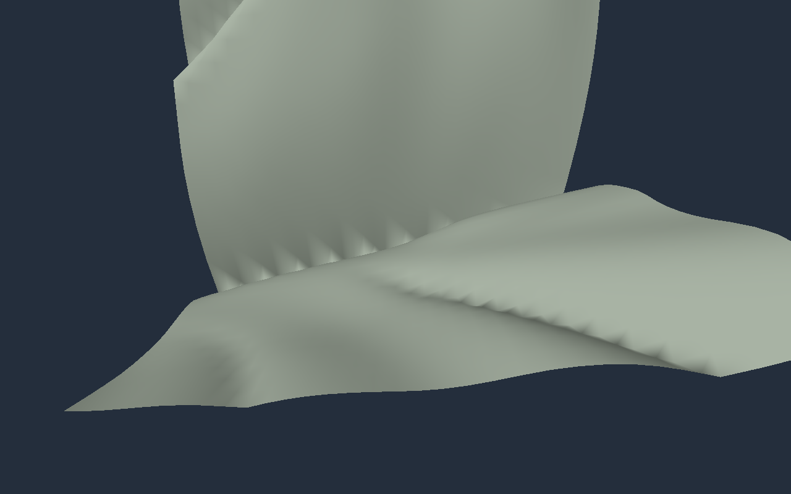
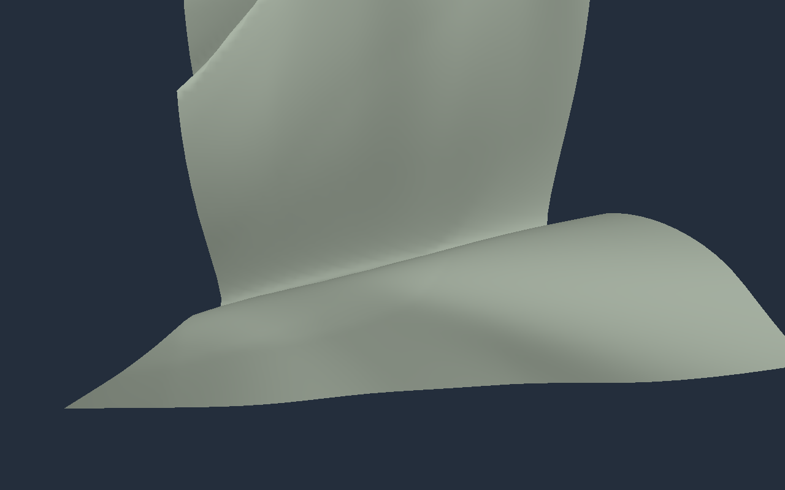

# Terrain crease sampling investigation

Status: historical crease-rounding investigation; the correction remains implemented.
The regional generator's separate ridge-direction artifact and current regressions
are covered by [ridge stability and rolling plains](terrain_ridge_stability.md).
See also [terrain system design](terrain_generation.md).

## Finding and decision

The sampled sharp creases were poorly represented by the original 0.5 m grid and its normals. Bilinear filtering changed interpolation but could not recover the missing samples. The baseline capture below reproduces the repeated scallops reported in the demo.

Use a crease-rounding coefficient of **0.3** by default, preserving the existing ridge-rounding coefficient of 0.1. This deliberately rounds valley/gully bottoms in the procedural height function rather than blurring the heightmap. Keep **0.5 m mesh spacing**, and evaluate heights/normals on a **0.25 m grid**. Geometry takes every second sample; fragment shading uses the full normal texture. Mesh vertex and triangle counts are unchanged.

This is a measured compromise, not an assertion that all artifacts are gone. Some angular geometry, sharp ridges, and distant aliasing can remain. The screenshot's exact camera position was unavailable; these are independently selected representative patches in the same default terrain.

## Method

Historical measurements below use the original uniform generator. The regional
generator has a new owned mountain regression fixture at chunk (165,165), 16 m
footprint; the sampling-study tool now uses the new defaults. These old metrics
are not measurements of the new geography.

Seed 1, wavelength 1024 m, height scale 400 m, erosion strength 0.22. Scan the default 512 m patch for large discrete second height differences, then inspect two high-curvature 16 m patches and one additional interior patch:

- A: world origin (464, 64), diagnostic chunk (29, 4).
- B: world origin (208, 336), diagnostic chunk (13, 21).
- C: world origin (208, 208), diagnostic chunk (13, 13).

Independently evaluate each patch at 0.5, 0.25, 0.125, and 0.0625 m spacing, using crease rounding 0, 0.1, 0.3, and 0.6. Keep the world function and domain fixed for each convergence comparison. The 0.0625 m result is the numerical reference, not exact ground truth.

Height error compares the actual two-triangle interpolation per coarse cell with dense reference heights. Normal error compares normalized bilinear interpolation of coarse normals with dense reference normals. Reference normals use central differences at the reference spacing. Normal statistics exclude texture quantization and camera projection; a separate pixel test covers rendering. Raw measured metrics are in [terrain_sampling/metrics.json](terrain_sampling/metrics.json).

## Results

Each configuration is compared to its **own** dense reference. Rounding changes the intended surface; these numbers measure representability, not closeness to the unrounded terrain.

| Patch | Old mesh height RMS / maximum | Rounded mesh height RMS / maximum | Old normal mean / 99th percentile | Rounded, finer normal mean / 99th percentile |
|---|---:|---:|---:|---:|
| A | 0.086 / 1.396 m | 0.024 / 0.174 m | 4.52° / 60.90° | 0.66° / 9.78° |
| B | 0.053 / 0.565 m | 0.027 / 0.240 m | 6.95° / 61.41° | 1.55° / 19.37° |
| C | 0.015 / 0.237 m | 0.005 / 0.056 m | 1.72° / 27.20° | 0.17° / 2.92° |

The old configuration is zero crease rounding and 0.5 m normals. The new configuration is rounding 0.3, 0.5 m mesh, and 0.25 m normals. In patch A, rounding alone reduces mean normal error to 1.92°; finer normal sampling reduces it further to 0.66°. Rounding 0.6 changes the surface more and provides diminishing or inconsistent benefits on the less problematic patch, so 0.3 was selected.

In the unrounded patch A, the largest adjacent height difference decreases from 2.95 to 1.60 to 0.85 to 0.43 m as spacing halves. This is consistent with steep continuous features rather than a persistent finite height jump. A finite scan does **not** prove continuity everywhere. The erosion accumulation, masks, gully direction updates, phase normalization, and noise derivative expressions were also checked against the [attributed C# translation](https://github.com/lpmitchell/AdvancedTerrainErosion/blob/main/package/Runtime/LPMGames.Terrain.Erosion/AdvancedTerrainErosion.cs); no obvious formula mismatch was found in those portions. Our seeded integer hash remains an intentional adaptation.

## Visual comparison

Identical patch A, camera, light, and 0.5 m topology. Camera reference elevation is 113.43360137939453 m. Patch boundaries are exposed because this is a cropped 16 m diagnostic region.

| Before: rounding 0, 0.5 m normals | After: rounding 0.3, 0.25 m normals |
|---|---|
|  |  |

The prominent repeated scallops are substantially reduced in this view. The [normal-colour capture](terrain_sampling/normals.png) and [wireframe overlay](terrain_sampling/wireframe.png) are available for inspection. These are actual rendered diagnostic captures, not reference images used to generate terrain.

## Reproduction and tests

Build with `OPENWORLD_GPU_TESTS=ON`. The probe runs the production pipeline and writes native float32 `TerrainSample` records (base normal.xyz/height, eroded normal.xyz/height), in row-major order. This is a diagnostic dump, not a portable world-cache format.

```sh
cmake --preset debug -DOPENWORLD_GPU_TESTS=ON
cmake --build --preset debug -j4
VK_DRIVER_FILES=/usr/share/vulkan/icd.d/lvp_icd.json python3 tools/terrain_sampling_study.py --out /tmp/terrain-study
```

The study requires NumPy, overwrites its output dumps, and writes JSON metrics plus CSV centre-line height profiles. It is deliberately outside routine CTest. A single patch and its three view captures can be reproduced with:

```sh
VK_DRIVER_FILES=/usr/share/vulkan/icd.d/lvp_icd.json cmake-build-debug/terrain_probe /tmp/crease-before.bin 32 0.5 29 4 0 1 1 capture 113.43360137939453
VK_DRIVER_FILES=/usr/share/vulkan/icd.d/lvp_icd.json cmake-build-debug/terrain_probe /tmp/crease-after.bin 32 0.5 29 4 0.3 1 2 capture 113.43360137939453
```

Arguments after the output path: cells, spacing, chunk X/Z, crease rounding, seed, normal subdivisions, optional `capture`, optional fixed reference elevation. Captures `.0.ppm`, `.1.ppm`, `.2.ppm` show lighting, normal colours, and wireframe respectively.

Routine regression tests use a smaller 0.125 m reference for patch A and require the rounded 0.5 m mesh error to remain substantially below the unrounded error. Other tests verify dense-normal texel addressing against independently generated 0.25 m data, unchanged geometry counts, planar fixtures, draw-only debug views, invalid rounding, and repeated in-flight edits under Vulkan synchronization validation.

Verification: Debug and Release CTest pass all four entries, including the sampling regression and denser-normal pixel checks. A full-size 1024-cell, two-subdivision offscreen run generated once across eight frames with zero validation errors. Measurements/captures use Mesa llvmpipe (LLVM 23.1.1). The current environment cannot load the NVIDIA ICD and exposes no NVIDIA device nodes; current hardware performance is unverified. Explicit lavapipe runs avoid that loader failure. No xdotool or scripted UI entry was used.

## Cost and remaining limits

The default patch preallocates about **152 MiB** of terrain storage, up from about 80 MiB: roughly 32 MiB dense heights, 32 MiB mesh samples, 24 MiB indices, and 64 MiB normal texture. This excludes render targets/driver overhead. Height/normal evaluation covers about four times as many samples when generation is requested. Cached frames do not rerun generation, and no terrain-owned allocations are introduced into ordinary frame processing.

One normal mip level is still used. Normal-map mip/filter policy, view-dependent geometry LOD, streaming budgets, and material detail normals remain future work. The UI exposes crease rounding for artistic control; zero restores razor-sharp creases and can reintroduce sampling artifacts.
